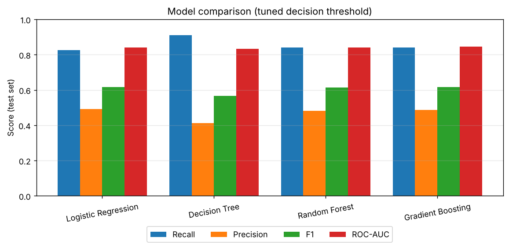
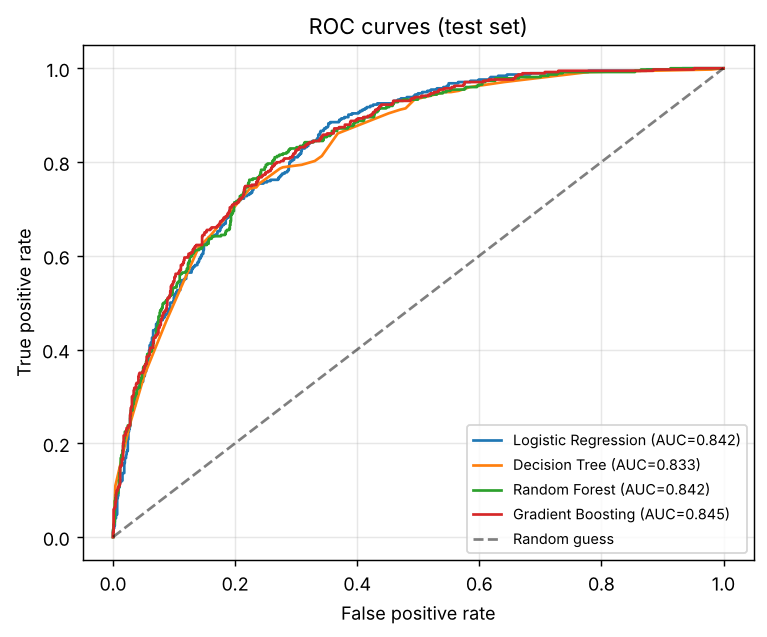
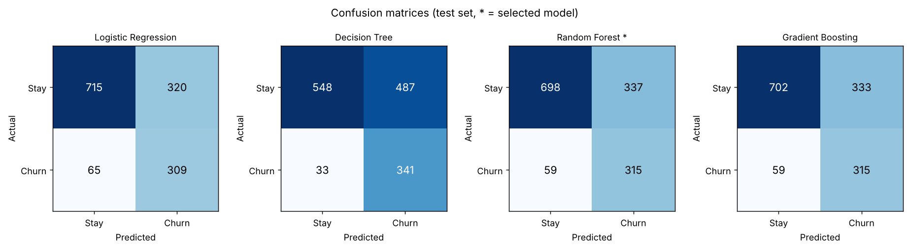
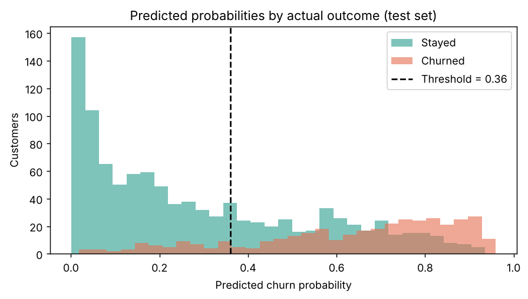
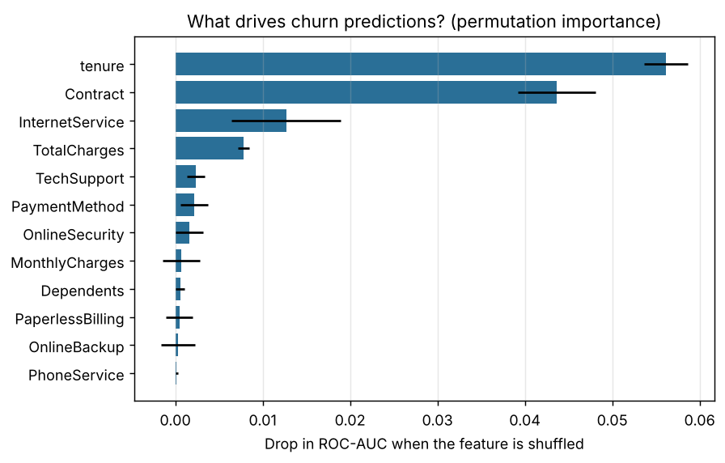

# Model Report - Customer Churn Prediction

_Generated automatically on 2026-11-14 05:46 by `src/train.py`._

## 1. Data
- Customers: **7,043** | Churn rate: **26.5%** (imbalanced: ~3 stayers per churner)
- Train / test split: 5,634 / 1,409 (stratified, `random_state=42`)
- Cleaning: blank `TotalCharges` (new customers, tenure 0) converted to 0; `customerID` dropped; target encoded Yes=1/No=0.
- Feature engineering: tenure group, number of add-on services, average monthly spend, charge delta, auto-pay flag, family flag, internet flag.

## 2. Methodology
- One sklearn `Pipeline` (feature engineering -> imputation/scaling/one-hot -> model), so no information leaks from the test set.
- 5-fold stratified cross-validation on the training data for every model.
- Because the classes are imbalanced, accuracy alone is misleading. The decision threshold for each model is tuned on
  **out-of-fold training predictions** to maximise **F1.5** (recall weighted 1.5x more than precision).
- The model is **selected by cross-validated F1.5, never by test results**; the test set is only used once for the final report.

**Why F1.5?** Losing a customer costs far more than a retention discount sent to someone who would have stayed anyway,
so the business wants to *catch* most churners (high recall) while keeping precision at a workable level.

## 3. Results

| Model | CV ROC-AUC | CV F1.5 (tuned) | Threshold | Test Accuracy | Test Precision | Test Recall | Test F1 | Test ROC-AUC |
|---|---|---|---|---|---|---|---|---|
| Logistic Regression | 0.845 ± 0.012 | 0.689 | 0.46 | 0.727 | 0.491 | 0.826 | 0.616 | 0.842 |
| Decision Tree | 0.829 ± 0.010 | 0.671 | 0.37 | 0.631 | 0.412 | 0.912 | 0.567 | 0.833 |
| Random Forest | 0.847 ± 0.010 | 0.696 | 0.36 | 0.719 | 0.483 | 0.842 | 0.614 | 0.842 |
| Gradient Boosting | 0.849 ± 0.012 | 0.691 | 0.20 | 0.722 | 0.486 | 0.842 | 0.616 | 0.845 |

## 4. Selected model: **Random Forest**
- Decision threshold: **0.36** (a customer is flagged as "likely to leave" when P(churn) >= this value).
- On the held-out test set (1,409 customers) it identifies **315 of 374 churners (84.2% recall)**
  with precision 48.3% (**337 loyal customers** flagged unnecessarily).
- ROC-AUC 0.842, accuracy 71.9%.

## 5. What drives churn?
1. **tenure** (ROC-AUC drop 0.056)
2. **Contract** (ROC-AUC drop 0.044)
3. **InternetService** (ROC-AUC drop 0.013)
4. **TotalCharges** (ROC-AUC drop 0.008)
5. **TechSupport** (ROC-AUC drop 0.002)
6. **PaymentMethod** (ROC-AUC drop 0.002)
7. **OnlineSecurity** (ROC-AUC drop 0.002)
8. **MonthlyCharges** (ROC-AUC drop 0.001)

## 6. Limitations & next steps
- Accuracy of ~80% is typical for this dataset; the data lacks usage/behavioural signals (calls, complaints, data usage), which limits any model.
- The threshold assumes a 2:1 cost trade-off. If the real cost of an offer vs. a lost customer is known, change `BETA` in `src/config.py`.
- Possible improvements: hyper-parameter search, probability calibration, SHAP explanations, monitoring for drift after deployment.
